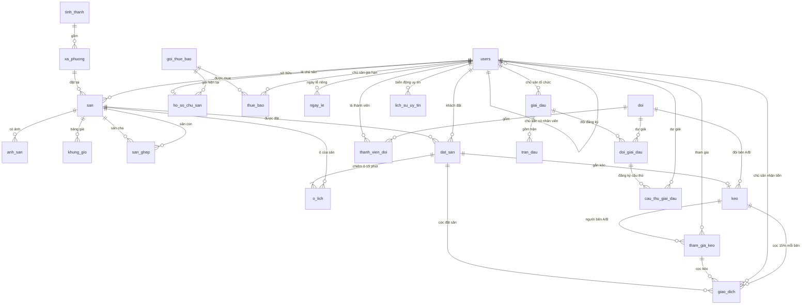

# Đặt sân bóng nhiều chủ sân — Phân tích & thiết kế CSDL

> Phiên bản 1 — 18/11/2026. Tài liệu này đi trước mọi dòng code; khi đổi thiết kế thì sửa ở đây trước.

## 1. Góp ý công nghệ

| Đề xuất ban đầu | Góp ý | Lý do |
|---|---|---|
| Laravel "bản mới nhất" | **Laravel 13** (ra mắt 17/3/2026), cần **PHP ≥ 8.3** | Hỗ trợ sửa lỗi tới Q3/2027, bảo mật tới Q1/2028. |
| XAMPP/Laragon | **Laragon** (hoặc Herd) | XAMPP thường đi kèm PHP 8.2 → không chạy được Laravel 13. Gõ `php -v` để kiểm tra. |
| Laravel Breeze | **Laravel Fortify + Socialite**, giao diện Blade + Bootstrap tự viết | Breeze không còn là starter kit chính thức (đã được thay bằng các kit React/Vue/Livewire dùng Tailwind). Fortify lo phần "lõi" (đăng ký, đăng nhập, xác thực email, quên mật khẩu, giới hạn đăng nhập sai) mà **không áp giao diện** → mình dùng Bootstrap 5 thoải mái. |
| Bootstrap 5 hay Tailwind | **Bootstrap 5** | Bạn đã quen, có skill giao diện Bootstrap, nhiều component sẵn (offcanvas, modal) hợp điện thoại. Giai đoạn đầu nạp qua CDN, chưa cần `npm`. |
| Pest hay PHPUnit | **PHPUnit** (Pest chạy được test PHPUnit nếu sau này đổi) | Ít khái niệm mới hơn khi vừa chuyển từ PHP thuần. |
| Tạo QR | **Tự sinh chuỗi VietQR (chuẩn EMVCo/NAPAS) ở server** rồi vẽ QR bằng thư viện PHP | Không phụ thuộc dịch vụ ảnh bên ngoài; QR luôn đúng số tiền + nội dung. |
| OTP số điện thoại | Giai đoạn đầu **chỉ ràng buộc UNIQUE**, cột `sdt_xac_thuc_luc` để sẵn; thêm OTP (Zalo ZNS hoặc SMS brandname) khi có doanh thu | OTP tốn tiền mỗi tin; email xác thực + UNIQUE đã chặn phần lớn tài khoản rác. |
| Queue | Driver `database` (bảng `jobs` có sẵn) + Supervisor trên VPS | Không cần Redis lúc đầu. |
| Triển khai | VPS Ubuntu (Nginx + PHP-FPM 8.3 + MariaDB) hoặc Laravel Forge/Ploi | Cần cron (`schedule:run` mỗi phút) và tiến trình queue chạy nền — shared hosting thường không cho. |

**Quy ước đặt tên** (lệch nhẹ so với skill CSDL thuần PHP, có chủ ý): tên bảng/cột tiếng Việt không dấu (`dat_san`, `gio_bat_dau`), **nhưng giữ quy ước Laravel** cho khoá: khoá chính `id`, khoá ngoại `<bang>_id`, thời gian `created_at/updated_at`, và giữ nguyên bảng `users`. Lý do: Eloquent, Fortify, Policy tự hiểu các tên này → bớt rất nhiều code cấu hình.

## 2. Giả định (bạn sửa nếu sai)

1. **Khung giờ không qua nửa đêm** (VD 22:30–24:00 được, 23:00–00:30 không). Giờ bắt đầu/kết thúc theo bội số **15 phút**.
2. Giá do chủ sân đặt theo **sân × loại ngày (thường / cuối tuần / lễ) × khung giờ**. Cuối tuần = Thứ 7, Chủ nhật. Ngày lễ: admin nạp lịch lễ chung, chủ sân thêm ngày riêng.
3. Cọc = **30%** giá khung giờ, làm tròn lên **nghìn đồng**. Cột `ty_le_coc` để sẵn (mặc định 30) nếu sau muốn cho chủ sân đổi.
4. **Admin tạo tài khoản chủ sân** sau khi bán gói (không cho tự đăng ký làm chủ sân). Tài khoản mới được **dùng thử 14 ngày**.
5. Chủ sân trả tiền gói cho admin bằng chuyển khoản; admin bấm xác nhận → gia hạn (tự động hoá sau).
6. Nhân viên cũng phải xác thực email; nhân viên bị chặn khi chủ sân của họ bị khoá/hết hạn.
7. Đặt tại chỗ (khách gọi điện): không cần tài khoản khách, lưu tên + SĐT; trạng thái `da_dat` ngay (cọc ghi nhận nếu có).
8. Đăng nhập Google: nếu email đã có tài khoản **chưa xác thực** thì Google thắng (người giữ hộp thư thật), mật khẩu/SĐT cũ bị xoá để chặn chiếm email.
9. Chống né phạt: ngoài UNIQUE email/SĐT, lưu thêm `email_chuan_hoa` (bỏ dấu chấm của Gmail, bỏ phần `+tag`) và đặt UNIQUE → `a.b+1@gmail.com` và `ab@gmail.com` là một.

## 3. Câu hỏi còn mơ hồ (không chặn giai đoạn 1–2)

1. **Tiền kèo đi về đâu?** Khách A đặt sân, tạo kèo tìm 5 người, mỗi người 100k. Cọc tham gia kèo chuyển vào **tài khoản chủ sân** (như đề bài) hay vào **tài khoản người tạo kèo**? Nếu vào chủ sân thì ai trả lại cho A?
2. **Cọc kèo bao nhiêu?** Bằng toàn bộ "tiền mỗi người", hay 30% như đặt sân, hay người tạo kèo tự nhập?
3. **Hủy khi đã đặt sân ghép**: đặt sân 11 rồi hủy thì mở lại các sân con ngay — đúng ý bạn?
4. **Giá gói thuê bao** (mình để tạm 299k / 599k / 999k mỗi tháng) và giới hạn mỗi gói (số sân, số nhân viên, có được dùng PayOS không)?
5. Điểm uy tín: bắt đầu **100**, vắng **−10**, đi đủ **+1** (tối đa 100)? "Vắng 3 lần" tính **trong 90 ngày gần nhất** hay cả đời?

### Quyết định ngày 18/11/2026

- **Huỷ sân ghép:** huỷ đơn sân 11 thì mở lại các sân con ngay. ✅
- **Thuê bao:** giai đoạn đầu miễn phí để thu hút chủ sân; sau đó 1 gói **199.000đ/tháng**.
- **Uy tín:** "vắng 3 lần" tính trong **30 ngày gần nhất** (cửa sổ trượt) → khoá vào kèo 30 ngày.
- **Kèo có 2 loại** (đã chốt 19/11/2026):
  - **Đội đấu đội (`doi_dau`)**: người đặt sân (bên A) tìm đối (bên B). Chọn trước tỉ lệ **đội thua chịu**: 5/5, 6/4, 7/3, hoặc thua trả hết 100%. **Hoà = 5/5.**
    Chốt kèo → **mỗi bên cọc 15% tiền sân**. VD sân 500k, 7/3: mỗi bên cọc 75k; sau trận thắng chịu 150k (trả thêm 75k), thua chịu 350k (trả thêm 275k).
  - **Xác nhận kết quả**: **cả hai bên bắt buộc bấm** đội thắng/hoà trong **60 phút** sau giờ kết thúc, được sửa nếu nhầm. Hai bên khớp → hoàn tất. Khác nhau → *tranh chấp*, chủ sân/nhân viên giám sát chốt. Quá 60 phút chưa đủ xác nhận → **khoá tài khoản thành viên hai bên** (chủ sân/admin mở lại).
  - **Ghép lẻ (`ghep_le`)**: đội thiếu người, người lẻ xin vào, trả `tien_moi_nguoi`, có thể cọc cá nhân.
  - **Vắng mặt**: trừ uy tín **cả đội** không đến; chủ sân được **miễn phạt từng người** thực tế có đến (`tham_gia_keo.mien_phat`).
  - Bảng: `keo` (loại, tỉ lệ, cọc mỗi bên, báo kết quả của A/B, hạn xác nhận, kết quả chốt), `tham_gia_keo` (thêm cột `ben` a/b, `vai_tro`, `mien_phat`), `giao_dich` (thêm `keo_id` + `ben`, UNIQUE mỗi bên 1 giao dịch cọc), `lich_su_uy_tin` (lý do dạng ENUM để đếm vắng trong 30 ngày).

## 4. Điểm thiết kế quan trọng: chống đặt trùng khi có SÂN GHÉP

`UNIQUE (san_id, ngay, khung_gio)` chỉ chặn trùng **trên cùng một sân với cùng khung giờ**. Nó không chặn được:
- sân 11 (ghép từ sân 5A, 5B) đặt 17:00–18:30, đồng thời có người đặt sân 5A 18:00–19:00 (khác khung giờ, khác sân);
- chủ sân sửa khung giờ làm hai khung chồng nhau.

**Giải pháp: bảng `o_lich` (ô lịch 15 phút).** Mỗi ngày của một sân chia thành 96 ô (ô 0 = 00:00–00:15, ô 68 = 17:00–17:15...). Khi đặt sân X từ 17:00–18:30, hệ thống chèn 6 ô (68..73) cho **X và mọi sân liên quan** (sân cha chứa X, các sân con của X). Bảng có `UNIQUE (san_id, ngay, o)` → **chỉ cần 1 ô trùng là MySQL từ chối cả giao dịch**, dù hai người bấm cùng mili-giây. Hủy/hết hạn giữ chỗ thì xoá các ô đó. Đây đúng tinh thần "ràng buộc ở CSDL, không chỉ kiểm tra bằng code", và mạnh hơn UNIQUE theo khung giờ.

Ví dụ: đặt sân 11 (gồm 5A, 5B) 17:00–18:30 → 6 ô × 3 sân = 18 dòng. Người khác đặt 5A 18:00 → ô 72 của 5A đã có → lỗi trùng khoá → báo "khung giờ vừa có người đặt".

## 5. Danh sách bảng

| Nhóm | Bảng | Ghi chú |
|---|---|---|
| Địa chỉ | `tinh_thanh`, `xa_phuong` | 34 tỉnh/thành sau 1/7/2025; không còn cấp huyện. |
| Tài khoản | `users` | Thêm `vai_tro`, `so_dien_thoai` (UNIQUE), `email_chuan_hoa` (UNIQUE), `chu_san_id` (nhân viên thuộc chủ sân), `trang_thai`, `google_id`, các cột hồ sơ cầu thủ & uy tín. |
| Thuê bao | `goi_thue_bao`, `ho_so_chu_san` (1–1 với users chủ sân), `thue_bao` (lịch sử mua/gia hạn) | `ho_so_chu_san` chứa: ngày hết hạn, cài đặt thanh toán (VietQR/PayOS, khoá API **mã hoá**), chính sách huỷ, phút giữ chỗ. |
| Sân | `san`, `anh_san`, `san_ghep`, `khung_gio`, `ngay_le` | `san_ghep(san_cha_id, san_con_id)`. |
| Đặt sân | `dat_san`, `o_lich` | `dat_san` chốt `gia_chot`, `tien_coc`, giờ bắt đầu/kết thúc tại thời điểm đặt. |
| Thanh toán | `giao_dich`, `webhook_log` | Lớp chung cho cọc đặt sân & cọc kèo; `webhook_log UNIQUE(cong, khoa_su_kien)` chống ghi trùng khi cổng gửi lặp. |
| Kèo | `keo`, `tham_gia_keo`, `lich_su_uy_tin` | |
| Đội & giải | `doi`, `thanh_vien_doi`, `giai_dau`, `doi_giai_dau`, `cau_thu_giai_dau`, `tran_dau` | `cau_thu_giai_dau` chụp danh sách cầu thủ lúc dự giải → thành tích không mất khi rời đội. |

## 6. ERD

## 7. Ràng buộc ở mức CSDL

- `users`: UNIQUE `email`, `email_chuan_hoa`, `so_dien_thoai`, `google_id`.
- `xa_phuong`: UNIQUE (`tinh_thanh_id`, `ten`).
- `san`: CHECK `loai_san IN (5,7,11)`; INDEX (`xa_phuong_id`, `loai_san`, `trang_thai`) cho bộ lọc trang chủ.
- `san_ghep`: khoá chính (`san_cha_id`, `san_con_id`), CHECK cha ≠ con.
- `khung_gio`: UNIQUE (`san_id`, `loai_ngay`, `gio_bat_dau`), CHECK `gia >= 0`, CHECK `gio_ket_thuc > gio_bat_dau`.
- `o_lich`: UNIQUE (`san_id`, `ngay`, `o`), CHECK `o BETWEEN 0 AND 95`.
- `dat_san`: UNIQUE `ma_don`; INDEX (`trang_thai`, `giu_cho_den`) cho scheduler nhả chỗ; CHECK `tien_coc <= gia_chot`.
- `giao_dich`: UNIQUE `noi_dung_ck` (VD `DS000123`), CHECK `so_tien > 0`.
- `webhook_log`: UNIQUE (`cong`, `khoa_su_kien`).
- `keo`: UNIQUE `dat_san_id` (1 ô tối đa 1 kèo), CHECK `ty_le_thua IN (50,60,70,100)`; `giao_dich`: UNIQUE (`keo_id`, `ben`).
- `tham_gia_keo`: UNIQUE (`keo_id`, `user_id`) — 1 người không đứng cả hai bên; `thanh_vien_doi`: UNIQUE (`doi_id`, `user_id`); `doi_giai_dau`: UNIQUE (`giai_dau_id`, `doi_id`).
- Tiền: `DECIMAL(12,0)`. Ảnh của sân, ô lịch: `ON DELETE CASCADE`; còn lại `RESTRICT` (không xoá được sân đã có đơn — dùng `trang_thai = tam_ngung`).

## 8. Kế hoạch giai đoạn

| # | Nội dung | Kết quả kiểm tra |
|---|---|---|
| 1 | Khung Laravel, toàn bộ migration, đăng ký/đăng nhập/xác thực email/quên mật khẩu, Google, vai trò, khoá tài khoản, admin tạo chủ sân, chủ sân tạo nhân viên | `php artisan test` xanh; đăng nhập thử 4 vai trò |
| 2 | Sân, ảnh, sân ghép, khung giờ & giá, ngày lễ | Test Policy: chủ sân A không sửa sân B |
| 3 | Lịch tuần, đặt sân, giữ chỗ 15', VietQR cách A, xác nhận cọc, đặt tại chỗ, huỷ/hoàn cọc, email | Test đặt trùng song song, test sân ghép |
| 4 | Trang chủ + bộ lọc + xem lịch không đăng nhập | Test không lộ tên người đặt |
| 5 | PayOS (cách B) qua interface chung, webhook, scheduler | Test chữ ký sai, sai số tiền, webhook lặp |
| 6 | Kèo, điểm danh, uy tín | |
| 7 | Đội, hồ sơ cầu thủ, giải đấu | |
| 8 | Gói thuê bao, hết hạn → khoá + ẩn sân | |
| 9 | Triển khai VPS, HTTPS, sao lưu hằng ngày | |
